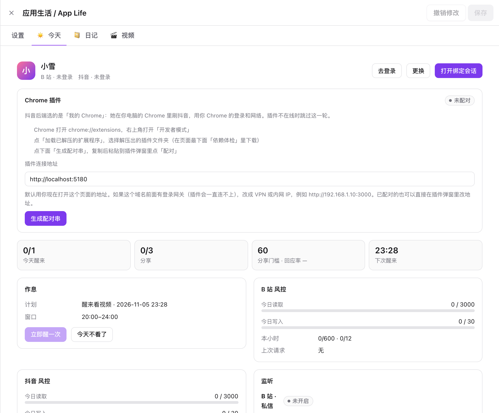
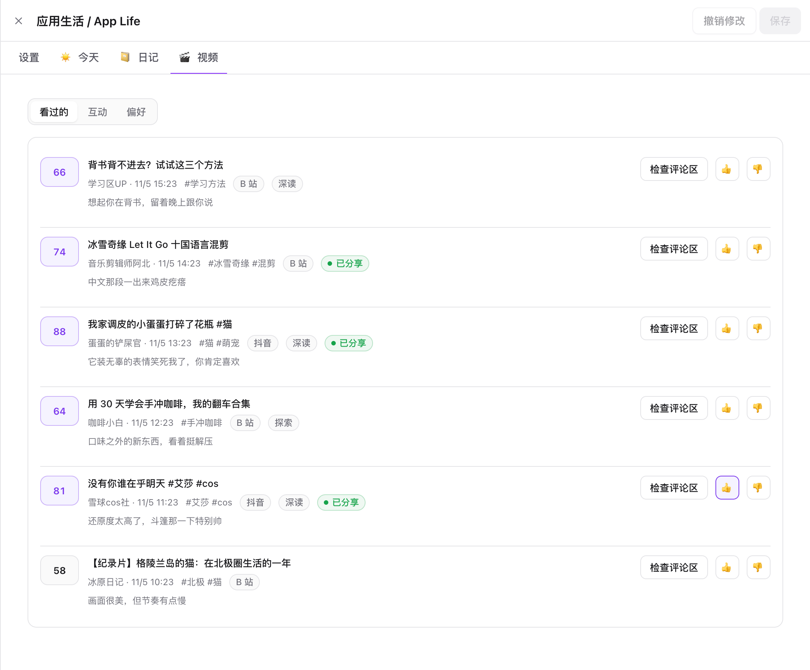
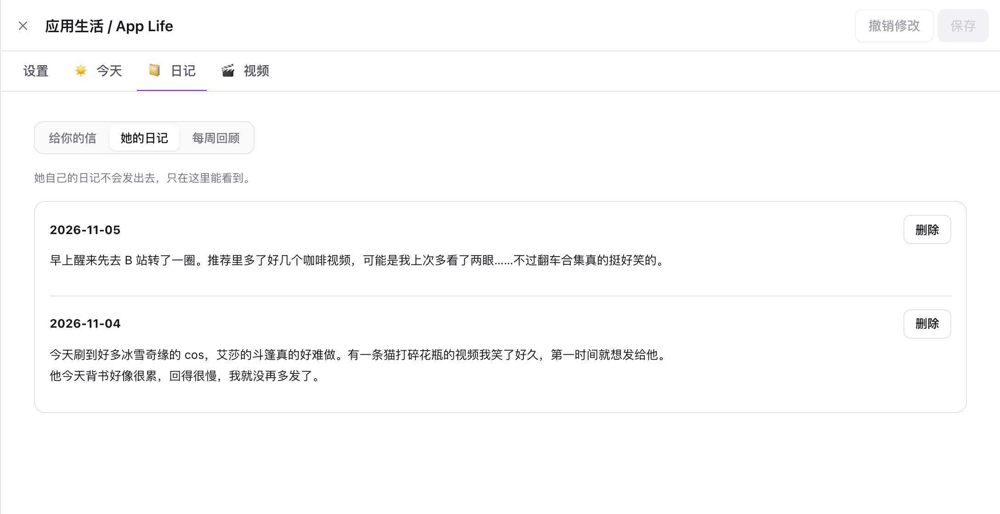
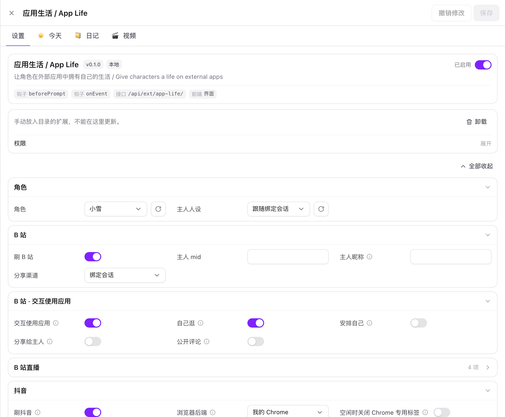
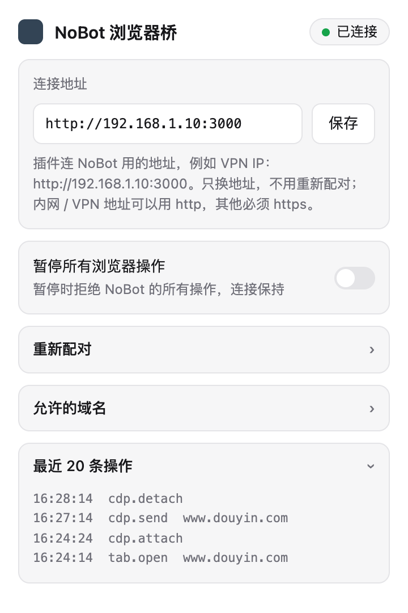

# 应用生活 / App Life

[NoBot](https://github.com/IamJasperJ/NoBot) 扩展：让角色在 B 站和抖音上拥有自己的生活。

她按自己的作息醒来刷视频，真的看懂内容（字幕、弹幕、热评，还能抽帧看画面），给每条视频打一个「心动值」，
把最想给你看的分享给你，晚上写一封给你的信和一篇只属于她自己的日记。你在 B 站或抖音私信她，她也会回。

*An extension for NoBot that gives your character a daily life on Bilibili and Douyin: she watches videos on her own schedule,
shares the ones you'd like, writes you letters and keeps a private diary.*



| 看过的视频 | 日记 |
| --- | --- |
|  |  |

## 功能

| 功能 | 说明 |
| --- | --- |
| 作息 | 在你设的时间窗口里随机醒来几次，偶尔「今天不想看」；错过的时段不补 |
| 选片与看片 | 推荐 + 按口味搜索，留约 20% 名额给口味之外的视频；先粗读文字，再挑最好的几条抽帧看画面 |
| 心动值 | 她给「自己多喜欢、你会不会喜欢、多想马上告诉你」打分，合成 0–100；过了门槛才分享 |
| 分享 | 默认在绑定会话里说；也可以在评论区 @ 你，或私信给你。每天有上限，同一视频只分享一次 |
| 学你的口味 | 你点 👍 / 👎、回不回应她的分享，都会调整她的偏好和分享门槛；常被忽略就自动变安静 |
| 信和日记 | 给你的信、她的私人日记、每周回顾；近期生活会作为记忆注入绑定会话 |
| 有人找她 | 回你的私信；评论区 @ 她的人先写草稿等你审；B 站直播间弹幕（可选） |
| 自己用应用 | 在绑定会话里，她可以按你的要求搜索、看视频、读评论、分享、发评论（需要模型支持工具调用） |
| 风控 | 读写预算、请求间隔、撞到风控自动暂停；写操作结果不确定时绝不自动重发 |
| 抖音浏览器 | 服务器无头浏览器，或通过「NoBot 浏览器桥」Chrome 插件借用你自己的 Chrome |

## 安装

需要 NoBot 服务器装有 Git。

1. NoBot →「扩展」→「安装」，填入本仓库地址：
   ```
   https://github.com/IamJasperJ/NoBot-extension-AppLife.git
   ```
   也可以从 [Releases](https://github.com/IamJasperJ/NoBot-extension-AppLife/releases) 下载 `app-life-<版本>.zip`，
   解压到 `<DATA_DIR>/users/<账号>/extensions/app-life/`，再在扩展页点刷新。
2. 确认权限（后台任务、访问 B 站和抖音域名）并启用。
3. 以后在扩展页点「更新」即可拉取新版本。

## 快速开始

1. **设置**：选角色、打开要刷的平台（B 站 / 抖音）、填你的账号（B 站 mid、抖音主页分享链接）、调作息窗口。
2. **今天**页：为每个平台登录**给她用的账号**（扫码或粘贴凭据），点「运行体检」。
3. **今天**页顶部：新建或指定「绑定会话」，她的分享都会发到这里。用 NoBot 的渠道把这个会话绑到 Telegram / QQ，手机上就能收到。
4. 抖音二选一：
   - **服务器浏览器**：「今天」页点「安装浏览器组件」（约 190 MB）。
   - **我的 Chrome**：设置里把抖音后端改成「我的 Chrome」，装好下面的 Chrome 插件并配对。
5. 想马上看效果：点「立即醒一次」。

## 控制方式

**页面**（扩展页 → 应用生活）

| 页面 | 做什么 |
| --- | --- |
| 设置 | 角色、平台开关、作息、分享渠道与门槛、风控预算、工具开关、看图连接 |
| 今天 | 今日计划与额度、各平台风控用量、监听状态、待审评论草稿、账号登录、浏览器、依赖体检、Chrome 插件配对 |
| 日记 | 给你的信 / 她的日记 / 每周回顾，可删除 |
| 视频 | 看过的视频和心动值（👍 / 👎 表态）、互动记录、口味偏好（可直接编辑） |

**在会话里**

- 直接和她聊：在绑定会话里回应她的分享，她会记住你喜不喜欢。
- 让她自己用应用：「去 B 站搜一下……」「看看这个视频 + 链接」「把这个分享到评论区」。需要在设置里打开对应平台的「交互使用应用」和细分开关。
- 斜杠命令：`/app status` 查看状态，`/app wake` 立即醒一次，`/app skip-today` 今天休息。



## Chrome 插件：NoBot 浏览器桥

抖音的接口必须由抖音网页自己签名。除了在服务器上跑无头浏览器，还可以让她借用**你电脑上的 Chrome**：
用你 Chrome 里的登录和网络，遇到验证码时你能直接在 Chrome 里处理。



1. 从「今天」页底部「依赖体检」下载插件，或在 [Releases](https://github.com/IamJasperJ/NoBot-extension-AppLife/releases) 下载 `nobot-chrome-<版本>.zip`，解压。
2. Chrome 打开 `chrome://extensions`，打开「开发者模式」，点「加载已解压的扩展程序」，选解压出的文件夹。
3. NoBot「今天」页点「生成配对串」，复制后粘贴到插件弹窗里点「配对」。
4. 插件只操作自己打开的标签页，只访问白名单域名（默认抖音、B 站），可以随时暂停或撤销配对。
   Chrome 顶部的「正在调试此浏览器」提示条请不要点「取消」，否则这一轮会跳过。

安全模型和协议见 [chrome/README.md](chrome/README.md) 与 [chrome/PROTOCOL.md](chrome/PROTOCOL.md)。

## 边界

- 不给陌生人发私信，不关注、不投币、不发动态，不批量操作，不绕过平台风控和验证码。
- 私信只发给你；回复陌生人的评论一定先经过你审核；公开发言不提你的隐私和私聊内容。
- 默认风控按新注册的小号设置。请使用专门给角色用的账号，并自行遵守平台规则。

## 更多

- [详细说明](docs/GUIDE.md)：一天怎么过、分享门槛、口味学习、风控参数、抖音与 B 站的差异、数据存放位置
- [ROUTES.md](ROUTES.md)：接口文档
- [NOTICE.md](NOTICE.md)：第三方来源

## 开发

扩展运行时只依赖 NoBot 宿主。类型检查和测试需要放在 NoBot 仓库的 `external-extension/app-life/` 下：

```bash
bun test external-extension/app-life
bunx tsc --noEmit -p external-extension/app-life
```

发版：把 `manifest.json` 的 `version` 改好后打同名标签（如 `v0.1.0`）并推送，GitHub Actions 会自动打包并创建 Release。

## 许可

[AGPL-3.0](LICENSE)，与 NoBot 相同。部分代码改编自 MIT 许可的项目，见 [NOTICE.md](NOTICE.md)。
